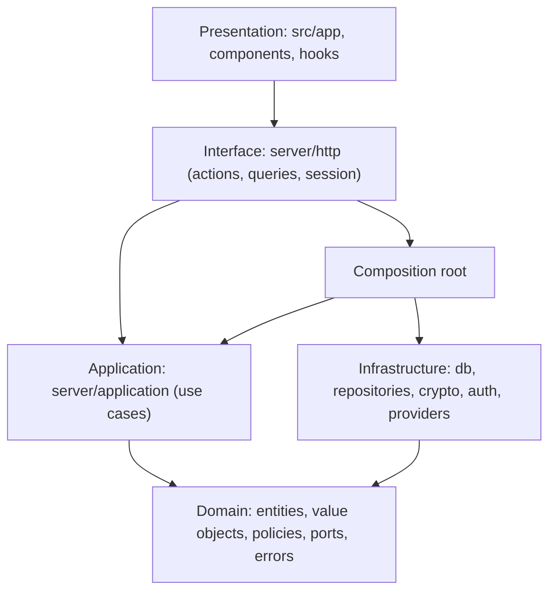
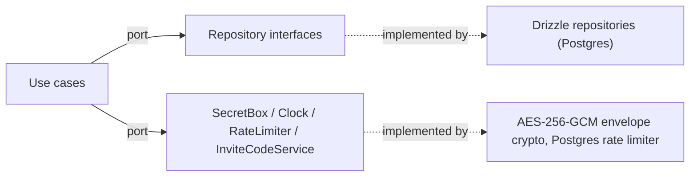
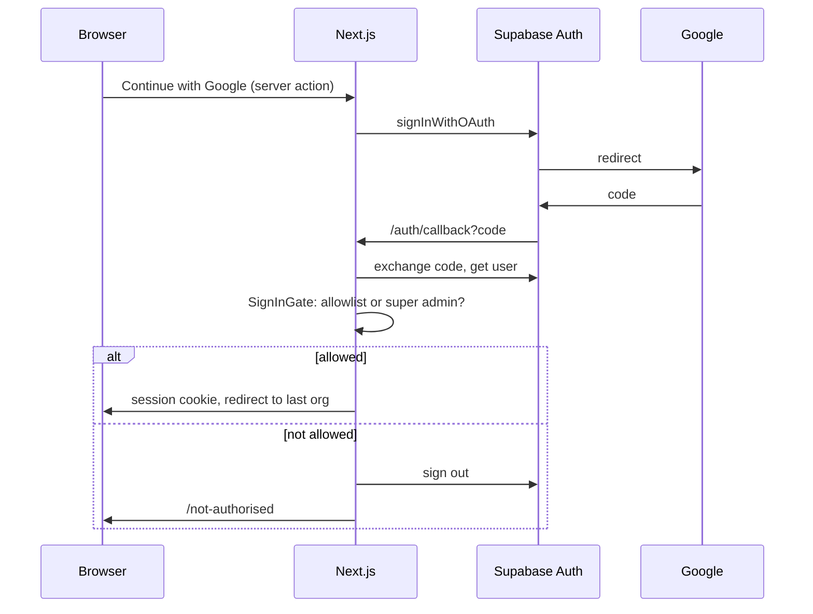
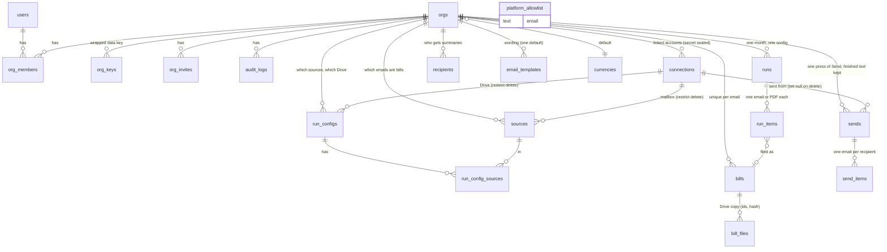
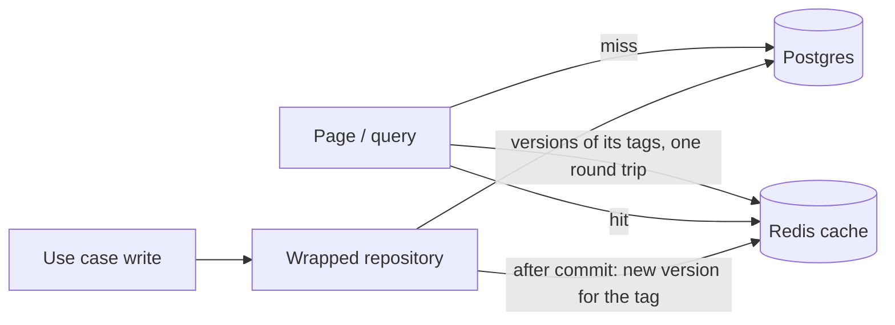
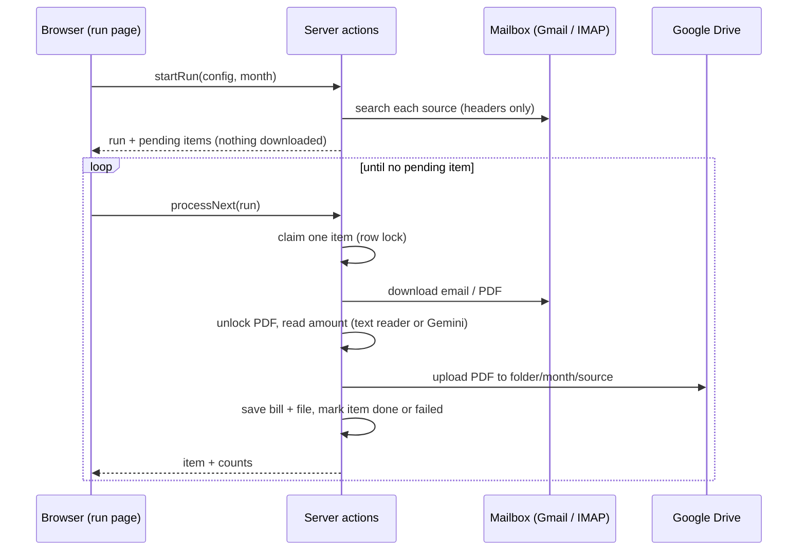
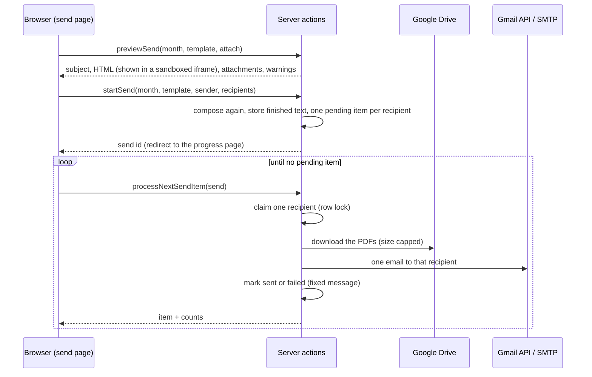

# Architecture

## Layers (dependencies point inward; enforced by `eslint-plugin-boundaries`)

`lib`, `constants` and `types` are shared leaf folders. Components may not import server code; use cases know only ports.

## Ports and adapters

Later phases add `MailSourceProvider` (Gmail API, IMAP), `MailSender` (Gmail API, SMTP), `FileStore` (Drive), `BillExtractor`
(Gemini, mock) and `PdfNormaliser` ports in `domain/ports`, selected through a `ProviderFactory` in the composition root.

## Sign-in sequence

Every request re-checks the allowlist (`isStillAllowed`), so removing someone takes effect at once.

## Data model (Phase 1-6 tables)

Sent emails copy the recipient's name and address and the finished subject and body, so removing a recipient, template or connection never changes history.

## Cache (ADR 0013)

`readThrough` (application) builds keys from the organisation's tag versions; `invalidating` (infra) wraps every repository and applies the effects listed in `infra/cache/specs.ts`; the allowlist and a person's organisation list are cached inside their repositories and deleted on write; Google access tokens and Drive folder ids are cached by the adapters that fetch them.

## Multi-tenancy
Every org-owned repository method takes an `orgId`; `AuthorizationService` resolves membership and permissions in one
place. A non-member gets `not_found`, never `forbidden`, so org existence is not leaked. RLS is enabled on every table
with no policies (deny by default) as a backstop for the public Supabase key.

## Filing pipeline (Phase 4)

## Sending pipeline (Phase 6)

`SendComposer` is the single place that builds the message, used by both the preview and the real send. `domain/value-objects/summary-email.ts` renders it (everything escaped); `email-template.ts` holds the allowed placeholders and limits.
