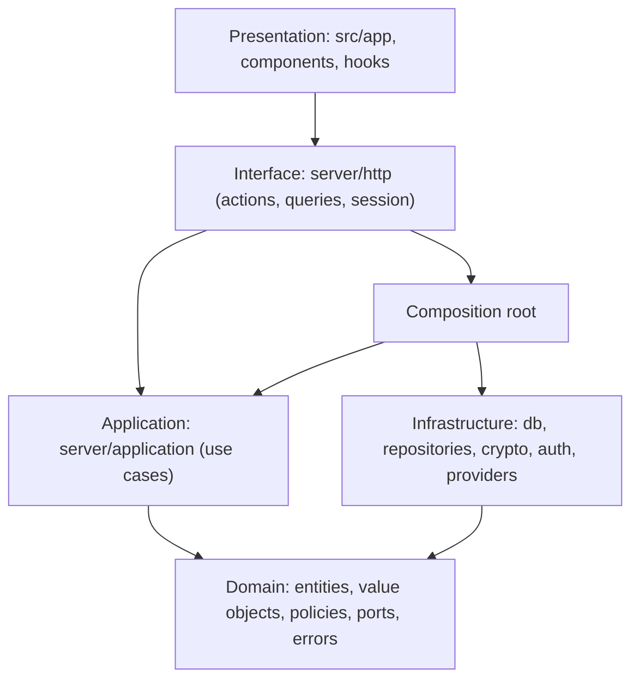
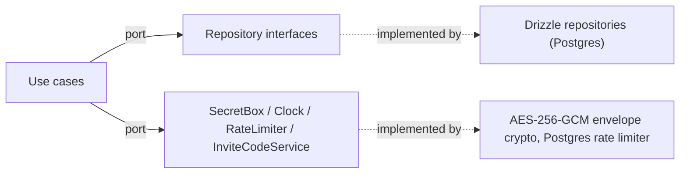
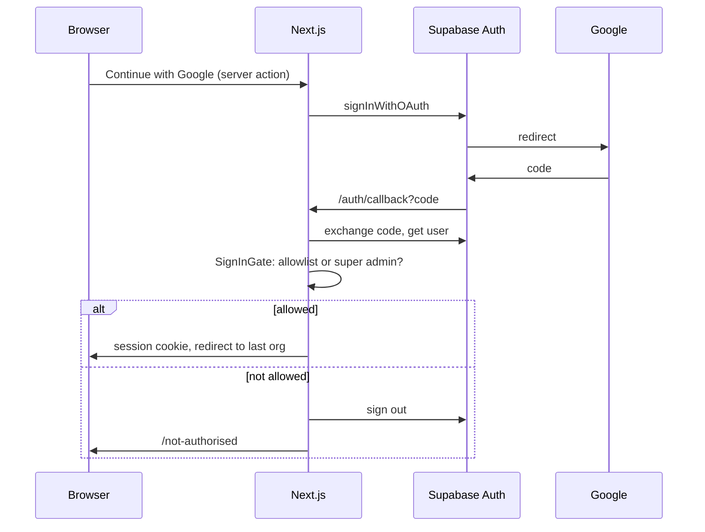
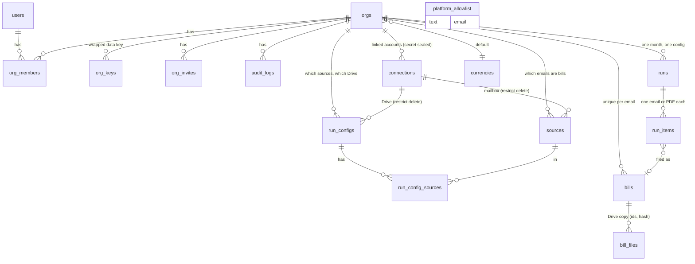
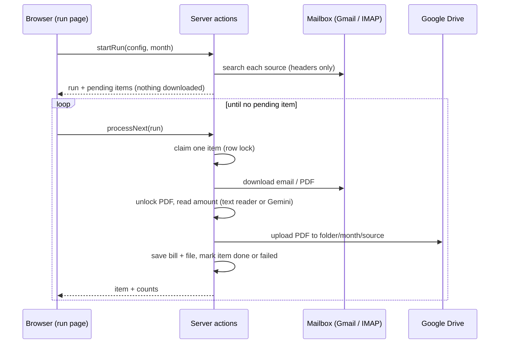

# Architecture

## Layers (dependencies point inward; enforced by `eslint-plugin-boundaries`)

`lib`, `constants` and `types` are shared leaf folders. Components may not import server code; use cases know only ports.

## Ports and adapters

Later phases add `MailSourceProvider` (Gmail API, IMAP), `MailSender` (Gmail API, SMTP), `FileStore` (Drive), `BillExtractor`
(Gemini, mock) and `PdfNormaliser` ports in `domain/ports`, selected through a `ProviderFactory` in the composition root.

## Sign-in sequence

Every request re-checks the allowlist (`isStillAllowed`), so removing someone takes effect at once.

## Data model (Phase 1-4 tables)

Later phases add reports, bills, files, recipients, templates and sends
(see the brief's data model; migrations are additive).

## Multi-tenancy
Every org-owned repository method takes an `orgId`; `AuthorizationService` resolves membership and permissions in one
place. A non-member gets `not_found`, never `forbidden`, so org existence is not leaked. RLS is enabled on every table
with no policies (deny by default) as a backstop for the public Supabase key.

## Filing pipeline (Phase 4)

